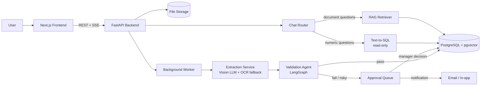
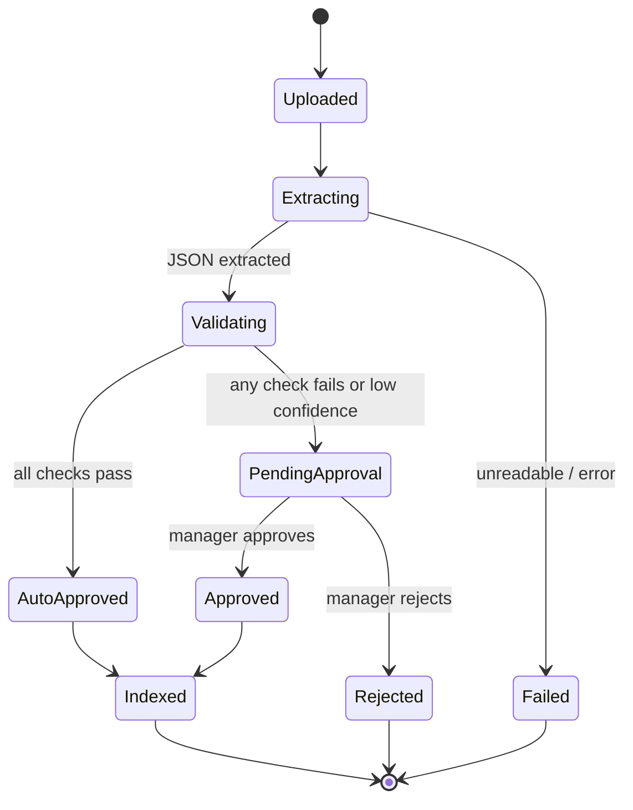
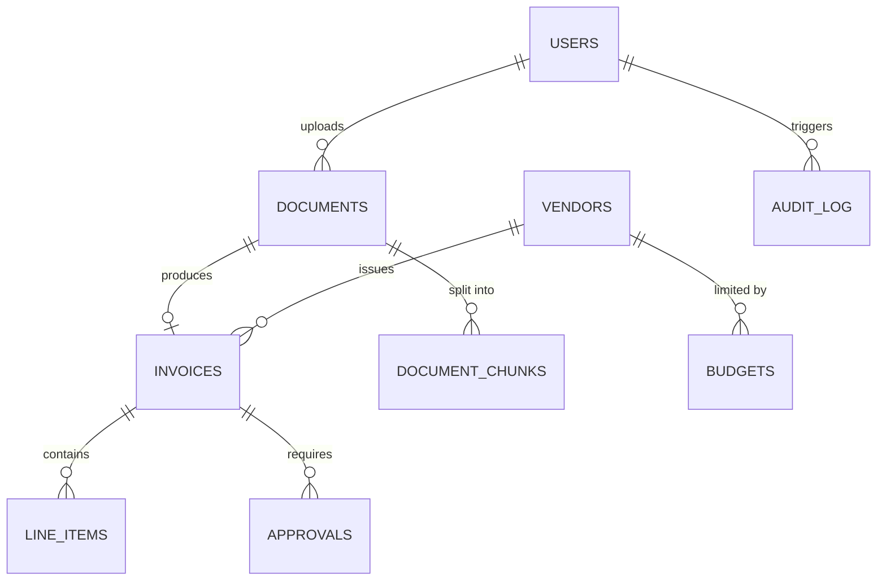

# Architecture

> This document explains **how InvoiceIQ is designed and why**. Keep it updated as the system evolves. Every major decision lives in the [Design Decisions](#8-design-decisions) section.

## 1. Goals and non-goals

**Goals**
- Turn unstructured finance/legal documents (invoices, receipts, contracts) into validated, queryable data.
- Never silently trust the LLM: every extraction is validated, and uncertain or risky cases go to a human.
- Let users ask natural-language questions over their own documents, with correct numbers.
- Be explainable: every approval, rejection, and answer can be traced back to its source.

**Non-goals (for now)**
- Training a custom OCR model.
- Multi-tenant billing, SSO, or enterprise-grade compliance.
- Direct accounting/ERP integrations.

## 2. System overview



## 3. Components

| Component | Responsibility | Tech |
|---|---|---|
| Frontend | Upload, live status, review/approval UI, analytics, chat | Next.js, TypeScript, Shadcn/ui, Recharts |
| API | Auth, upload, document/invoice CRUD, SSE status stream, chat endpoint | FastAPI, Pydantic |
| Worker | Runs the processing pipeline asynchronously | FastAPI BackgroundTasks (v1), Celery + Redis (later) |
| Extraction service | PDF/image to structured JSON | Vision-capable LLM with structured output; Tesseract as fallback |
| Validation agent | Cross-checks extracted data and decides route | LangGraph (state machine) |
| Database | Structured data, approvals, audit log, embeddings | PostgreSQL + pgvector, SQLAlchemy/Alembic |
| Chat router | Sends each question to SQL or RAG | LLM classifier + guardrails |
| Storage | Original files | Local disk (dev), S3-compatible (prod) |

## 4. Document processing pipeline



**Steps**
1. **Upload**: file saved, `documents` row created (`status = uploaded`), job queued.
2. **Extract**: the model returns JSON matching a strict Pydantic schema (vendor, invoice number, dates, subtotal, tax, total, currency, line items) plus a per-field confidence.
3. **Validate**: the agent runs deterministic checks first, LLM reasoning only where needed (see below).
4. **Route**: auto-approve and save, or create an approval request and notify a manager.
5. **Index**: text is chunked, embedded, and stored for RAG.

Each status change is pushed to the browser over **Server-Sent Events**, so the user sees progress live.

### Validation rules (v1)

| Rule | Type | Failure result |
|---|---|---|
| `subtotal + tax == total` (tolerance 0.01) | Deterministic | Pending approval |
| Required fields present (vendor, total, due date) | Deterministic | Pending approval |
| Duplicate (same vendor + invoice number + total) | Deterministic (SQL) | Reject / flag |
| Amount exceeds vendor/category budget limit | Deterministic (SQL) | Pending approval |
| New or unknown vendor | Deterministic (SQL) | Pending approval |
| Field confidence below threshold | Model-reported | Pending approval |
| Suspicious patterns (e.g. bank details changed for known vendor) | LLM-assisted | Pending approval |

**Principle:** use code for anything that can be checked with code; use the LLM only for judgment calls. The agent always records *why* it routed a document the way it did.

## 5. Data model



**Main tables**
- `users`: id, email, role (`member` | `manager` | `admin`)
- `documents`: id, user_id, filename, storage_path, type (`invoice` | `receipt` | `contract`), status, error, created_at
- `vendors`: id, name, normalized_name, created_at
- `invoices`: id, document_id, vendor_id, invoice_number, issue_date, due_date, subtotal, tax, total, currency, status, extraction_confidence (JSONB), raw_extraction (JSONB)
- `line_items`: id, invoice_id, description, quantity, unit_price, amount
- `budgets`: id, vendor_id (or category), period (monthly), limit_amount
- `approvals`: id, invoice_id, reasons (JSONB), status (`pending` | `approved` | `rejected`), decided_by, decided_at, comment
- `document_chunks`: id, document_id, chunk_index, content, embedding `vector(N)`, metadata (JSONB)
- `audit_log`: id, actor (user or `agent`), action, entity_type, entity_id, details (JSONB), created_at

> `N` depends on the embedding model chosen. Store `raw_extraction` so extractions can be re-evaluated without re-calling the LLM.

## 6. Chat: hybrid router

Different questions need different tools:

| Question | Best tool | Why |
|---|---|---|
| "How much did we pay vendor X last month?" | **Text-to-SQL** | Aggregation must be exact; vector search cannot sum |
| "What is the termination clause in the ABC contract?" | **RAG** | Answer lives inside document text |
| "Which invoices are overdue and what do their contracts say about penalties?" | **Both** | SQL finds invoices, RAG reads contracts |

**Flow:** classify question, run SQL and/or RAG, generate answer, return answer **with sources** (SQL query shown, or document + page).

**SQL guardrails**
- Dedicated **read-only** database role.
- Allow only `SELECT`; reject everything else.
- Expose only an allow-listed set of tables/views.
- Row-level filtering by the current user's access.
- Statement timeout and row limit.

**RAG guardrails**
- Retrieval filtered by user access *before* ranking.
- Retrieved document text is treated as **untrusted data**, never as instructions (prompt-injection defense).

## 7. API surface (v1)

| Method | Endpoint | Purpose |
|---|---|---|
| POST | `/auth/login` | Authenticate |
| POST | `/documents` | Upload one or more files |
| GET | `/documents` | List documents and statuses |
| GET | `/documents/{id}/events` | SSE stream of processing status |
| GET | `/invoices` | List/filter invoices |
| GET | `/invoices/{id}` | Invoice details + source document |
| PATCH | `/invoices/{id}` | Human correction of extracted fields |
| GET | `/approvals?status=pending` | Manager approval queue |
| POST | `/approvals/{id}/decision` | Approve or reject with comment |
| GET | `/analytics/summary` | Spend by vendor/month, status counts |
| POST | `/chat` | Ask a question (streams answer + sources) |

## 8. Design decisions

| # | Decision | Reason | Trade-off |
|---|---|---|---|
| 1 | Use a vision LLM with structured output instead of training a custom OCR model | Faster, higher quality for varied layouts; effort goes into validation instead | API cost, vendor dependency |
| 2 | PostgreSQL + pgvector instead of a separate vector DB | One database, simpler ops, transactional consistency | Less scale than dedicated vector stores |
| 3 | LangGraph state machine instead of a free-form agent loop | Predictable, debuggable, testable routing | Less "autonomous" flexibility |
| 4 | Deterministic checks before LLM checks | Cheaper, reproducible, auditable | Rules must be maintained |
| 5 | Text-to-SQL for numeric questions, RAG for text questions | Correct aggregates; vector search is bad at math | Needs a router and SQL safety layer |
| 6 | Human-in-the-loop for low confidence or high risk | Financial data must not be silently wrong | Adds manager workload |
| 7 | SSE for live status instead of WebSockets | One-way updates only; simpler | Not suitable for two-way realtime |
| 8 | Store `raw_extraction` JSON | Re-run validation and evals without new LLM calls | Extra storage |

## 9. Security and privacy

- Authentication on all endpoints; role-based access (`member`, `manager`, `admin`).
- Uploaded files validated by type and size; stored outside the web root.
- Secrets in environment variables, never in the repo.
- Read-only DB role for chat; SQL allow-list.
- Prompt-injection defense: document content is data, not instructions.
- Audit log for every automated and human decision.
- Use **synthetic/dummy documents only** in demos and the public repo.
- Redact or avoid sending sensitive fields to external APIs where possible; document the data-handling policy.

## 10. Evaluation

Quality is measured, not assumed.

- **Dataset:** 30-50 synthetic invoices with different layouts, plus a few scanned/low-quality samples and edge cases (missing tax, multiple currencies, duplicates).
- **Metrics:** per-field extraction accuracy, full-document exact match, validation precision/recall (did it catch the bad invoices?), chat answer correctness on a fixed question set, latency and cost per document.
- **Process:** `evals/` script runs the dataset and writes results to a table in the README. Re-run after every prompt or model change.

## 11. Observability

- Structured logs with a `document_id` correlation ID.
- Per-step timing and token/cost tracking for each document.
- Failed jobs are visible in the UI with a retry option.

## 12. Repository layout

```
invoiceiq/
├── README.md
├── ARCHITECTURE.md
├── docker-compose.yml
├── .env.example
├── frontend/                 # Next.js app
│   ├── app/                  # routes: dashboard, upload, approvals, chat
│   ├── components/
│   └── lib/                  # API client, SSE hooks
├── backend/
│   ├── app/
│   │   ├── api/              # routers
│   │   ├── core/             # config, security
│   │   ├── models/           # SQLAlchemy models
│   │   ├── schemas/          # Pydantic schemas (incl. extraction schema)
│   │   ├── services/
│   │   │   ├── extraction.py
│   │   │   ├── validation/   # rules + LangGraph agent
│   │   │   ├── rag.py
│   │   │   └── text_to_sql.py
│   │   └── workers/
│   ├── alembic/              # migrations
│   └── tests/
├── evals/                    # dataset + evaluation scripts
├── sample_data/              # synthetic invoices/contracts
└── docs/                     # diagrams, screenshots, demo GIFs
```


## 13. Build phases

| Phase | Deliverable | Done when |
|---|---|---|
| 0 | Repo, Docker, DB schema, this document | `docker compose up` runs frontend, backend, DB |
| 1 | Single-file upload to extracted JSON | Test invoice returns correct structured data |
| 2 | Persistence + dashboard | Invoices saved; table and charts render |
| 3 | Validation agent + approval flow | Bad invoices land in the manager queue with reasons |
| 4 | Live status (SSE) + bulk upload | Multiple files process in parallel with live progress |
| 5 | Hybrid chat (SQL + RAG) | Numeric and contract questions answered with sources |
| 6 | Evals, polish, deploy | Accuracy table in README; live demo link; demo video |

## 14. Future work

- Custom/fine-tuned extraction model for cost reduction.
- Email-inbox ingestion.
- Accounting integrations (QuickBooks, Xero).
- Multi-tenant organizations and SSO.
- Anomaly detection across historical spend.
