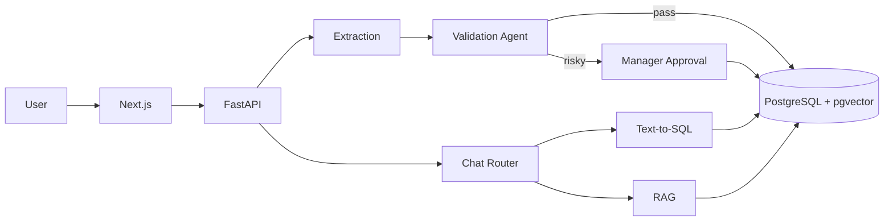

# InvoiceIQ: AI-Driven Invoice & Contract Intelligence Hub

> Upload invoices and contracts, let AI extract and validate the data, route risky documents to a human for approval, and ask questions about your documents in plain English.

<!-- Replace with your own: demo GIF, screenshots, live link -->
**Live demo:** _coming soon_ | **Demo video:** _coming soon_


---

## The problem

Finance and legal teams spend hours re-typing data from PDFs and scans, checking it against budgets, and digging through contracts to answer simple questions. Manual entry is slow and error-prone, and blindly trusting AI extraction is risky when the data is money.

## The solution

InvoiceIQ automates the boring part and keeps humans in control of the risky part:

1. **Upload** bulk PDFs or images.
2. **Extract** vendor, invoice number, dates, subtotal, tax, total and line items with an LLM.
3. **Validate** with an agent that cross-checks the data (math, duplicates, budget limits, unknown vendors, low confidence).
4. **Route**: clean invoices are saved automatically; anything suspicious goes to a manager's approval queue with the reasons.
5. **Ask** questions such as *"How much did we pay XYZ Traders last month?"* or *"What is the termination clause in the ABC contract?"*

## Features

- [ ] Bulk upload (PDF, JPG, PNG) with **live processing status** (streaming)
- [ ] Structured extraction with per-field confidence scores
- [ ] Human correction of extracted fields
- [ ] **Validation agent** (LangGraph) with deterministic checks plus LLM judgment
- [ ] **Approval workflow** with manager queue, comments and notifications
- [ ] **Analytics dashboard**: spend by vendor, monthly trends, status breakdown
- [ ] **Hybrid chat**: Text-to-SQL for numbers, RAG for document content, with sources shown
- [ ] Audit log of every automated and human decision
- [ ] Role-based access (member / manager / admin)
- [ ] Evaluation suite with published accuracy results

_Tick these off as you build them._

## What makes it different

- **Validation over blind trust:** code handles what code can check; the LLM handles judgment calls; humans handle risk.
- **Right tool for each question:** aggregates go through read-only SQL, not vector search, so totals are exact.
- **Measured quality:** accuracy is evaluated on a labeled dataset (see below), not assumed.
- **Explainable:** every decision and answer comes with its reason and source.

## Tech stack

| Layer | Technology |
|---|---|
| Frontend | Next.js, TypeScript, Shadcn/ui, Recharts |
| Backend | FastAPI (Python), Pydantic, SQLAlchemy, Alembic |
| Database | PostgreSQL + pgvector |
| AI | Vision-capable LLM API (structured output), embeddings, LangGraph |
| Jobs | FastAPI BackgroundTasks (Celery + Redis later) |
| DevOps | Docker, Docker Compose |

## Architecture (short version)



Full details, data model, validation rules and design decisions: **[ARCHITECTURE.md](ARCHITECTURE.md)**

## Evaluation results

_Fill this in after running `evals/`. This table is the most valuable part of the README._

| Metric | Result |
|---|---|
| Documents in eval set | _e.g. 40 synthetic invoices_ |
| Field-level extraction accuracy | _xx%_ |
| Full-document exact match | _xx%_ |
| Bad invoices correctly flagged (recall) | _xx%_ |
| Chat answer correctness (fixed question set) | _xx / yy_ |
| Avg. time per document | _x s_ |
| Avg. cost per document | _$0.00x_ |

## Getting started

### Prerequisites
- Docker and Docker Compose
- An API key for your LLM provider

### Run locally

```bash
git clone https://github.com/Javeria-5091/invoiceiq.git
cd invoiceiq

cp .env.example .env
# edit .env and add your API key

docker compose up --build
```

- Frontend: http://localhost:3000
- API docs: http://localhost:8000/docs

### Environment variables

| Variable | Description |
|---|---|
| `DATABASE_URL` | PostgreSQL connection string |
| `LLM_API_KEY` | API key for the LLM provider |
| `EMBEDDING_MODEL` | Embedding model name |
| `SECRET_KEY` | Secret for signing auth tokens |
| `STORAGE_PATH` | Where uploaded files are stored |

### Try it with sample data

Synthetic invoices and contracts are in `sample_data/`. Upload them from the dashboard to see extraction, validation and approval in action.

> All sample documents are fake. Never commit real invoices or contracts.

## Project structure

```
invoiceiq/
├── frontend/      # Next.js app
├── backend/       # FastAPI app, services, agent
├── evals/         # Evaluation dataset and scripts
├── sample_data/   # Synthetic documents
└── docs/          # Diagrams, screenshots
```

## Roadmap

- [ ] Phase 0: repo, Docker, DB schema
- [ ] Phase 1: upload and extraction
- [ ] Phase 2: persistence and dashboard
- [ ] Phase 3: validation agent and approvals
- [ ] Phase 4: live status and bulk upload
- [ ] Phase 5: hybrid chat (SQL + RAG)
- [ ] Phase 6: evals, polish, deployment

## Security and privacy

Read-only DB role for chat, SQL allow-list, role-based access, audit logging, and prompt-injection-aware document handling. Details in [ARCHITECTURE.md](ARCHITECTURE.md#9-security-and-privacy).

## Limitations

- LLM extraction can be wrong; that is why low-confidence and high-risk documents go to a human.
- Evaluated on synthetic data; real-world documents may behave differently.
- Not production-hardened for multi-tenant use.

## What I learned

_Write 3-4 honest bullets here at the end: what was hard, what you would change, what surprised you. Recruiters read this section._

## License

MIT

## Author

**Javeria**: BS Computer Science | [LinkedIn](https://www.linkedin.com/in/javeria-nadeem-b02197320/) | [GitHub](https://github.com/Javeria-5091)
